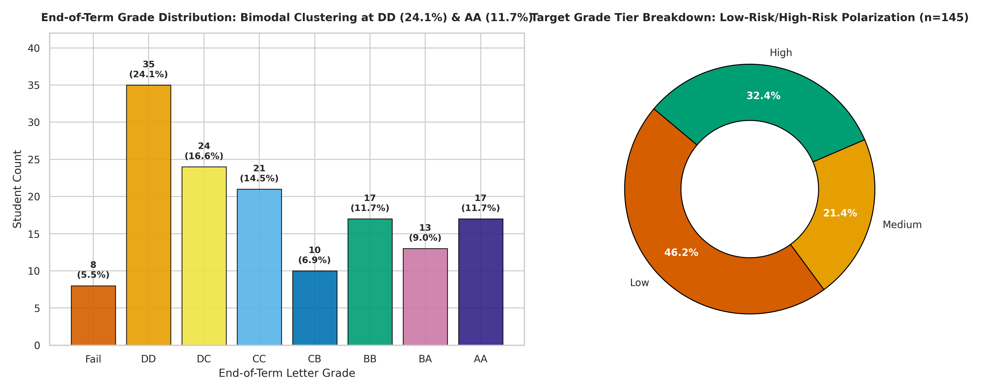
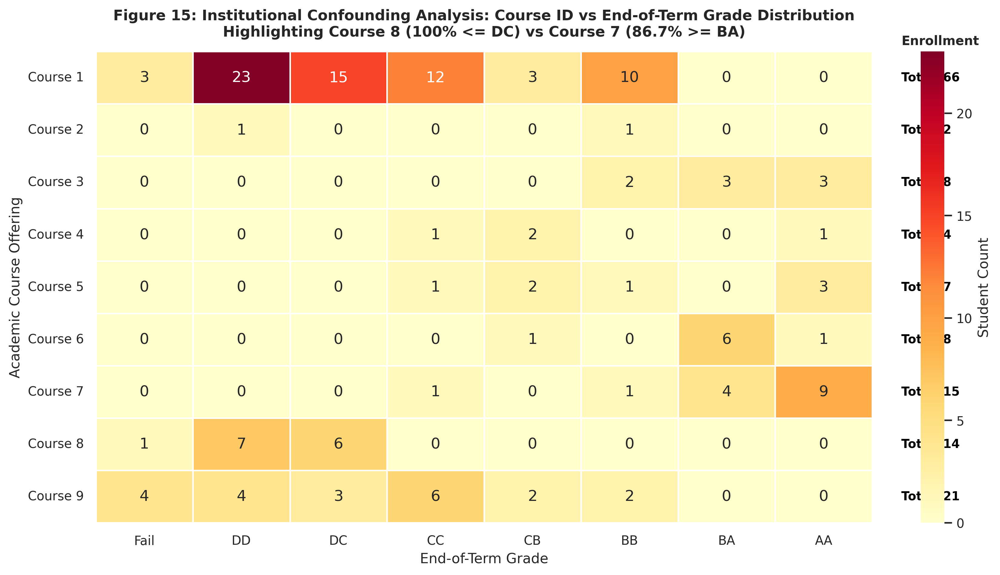
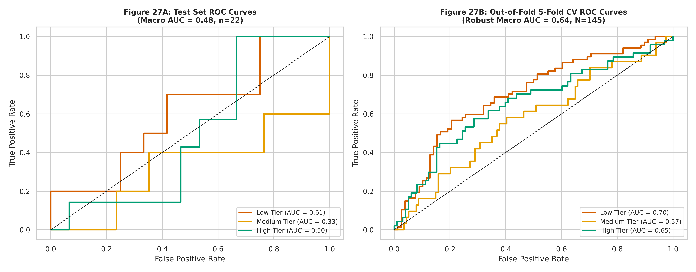

# Higher Education Students' Performance Evaluation: Exploratory Data Analysis, Statistical Visualization, and Deep Learning
### An Early-Warning and Academic-Advising Decision Support System for University Student Retention

[](https://www.python.org/downloads/)
[](https://colab.research.google.com/github/prajith-sabarish/higher-education-students-performance-evaluation/blob/main/notebooks/01_EDA_Visualization.ipynb)
[](https://opensource.org/licenses/MIT)
[](https://www.tensorflow.org/)
[](https://scikit-learn.org/)
[](https://www.oreilly.com/library/view/visualizing-data/9780596514556/)

---

## 1. Executive Summary & Problem Statement

Academic failure and university attrition represent severe institutional and socio-economic challenges. In higher education, traditional academic intervention systems are almost entirely **reactive**—interventions occur only after final semester examinations are graded and academic probation or expulsion notices are issued.

This case study designs, develops, and evaluates an automated, proactive **Early-Warning and Academic Advising System**. By analyzing demographic background, family socioeconomic status, cognitive engagement habits, and historical academic trajectory from university students (Faculty of Engineering and Faculty of Educational Sciences; Yilmaz & Sekeroglu, 2019), this investigation discovers the root causes of underperformance and predicts students likely to earn low end-of-term grades.

The study is structured rigorously according to **Ben Fry's Seven Stages of Data Visualization** (*Acquire, Parse, Filter, Mine, Represent, Refine, Interact*) and implements a complete end-to-end data science pipeline combining inferential statistics, probability distribution modeling, multivariate dimensionality reduction (PCA), and deep neural network classification (Keras MLP).

---

## 2. Dataset Provenance & Attributes
- **Source:** UCI Machine Learning Repository
- **Authors:** Nevruz Yilmaz and Boran Sekeroglu (2019), Department of Computer Engineering, Near East University, Cyprus.
- **Citation:**
  > Yilmaz, N., & Sekeroglu, B. (2019). Student Performance Evaluation using Machine Learning Techniques. *International Journal of Advanced Trends in Computer Science and Engineering*, 8(1.2), 200–207.
- **Dataset Geometry:** 145 student records $\times$ 33 columns (1 Student ID, 30 integer survey features, 1 Course ID, 1 Target Grade).
- **Integrity Verification:** 0 missing values, 0 duplicate rows, 100% verified integer domain bounds.
- **Target Distribution (`GRADE`):** Fail: 8, DD: 35, DC: 24, CC: 21, CB: 10, BB: 17, BA: 13, AA: 17 ($\mu = 3.23$, $\text{Median} = 3$, $\sigma = 2.20$).
- **Consolidated Target Tiers (`Grade_Group`):**
  - **Low Attainment (Grades 0-2):** 67 students (46.2%)
  - **Medium Attainment (Grades 3-4):** 31 students (21.4%)
  - **High Attainment (Grades 5-7):** 47 students (32.4%)

---

## 3. Key Empirical Findings & Insights

1. **Prior Academic Momentum Dominates:**
   Prior Cumulative GPA (`GPA_Last`) is the single strongest positive predictor of final grade ($\rho = +0.351, p = 0.000015$). Students entering a course with prior GPA $< 2.00$ average a final grade of DD (1.0), whereas those with GPA $> 3.49$ achieve BB/AA (5.0–7.0).
2. **Attendance is a Necessary Foundation:**
   Students attending lectures only "Sometimes" exhibit a **62.9% probability** of ending in the Low Attainment tier, compared to **40.9%** for regular attenders.
3. **Study Hours Plateau:**
   Weekly study hours exhibit a non-linear plateau beyond 10 hours. Logging excessive hours ($>20$ hours) without active engagement does not yield higher grades than efficient 6–10 hour routines.
4. **Institutional Course Confounding:**
   Academic course offering acts as a powerful institutional confounder ($\chi^2 = 37.29, p < 0.0001$). In Course 8 ($n=14$), **100% of students scored DC or below**, whereas in Course 7 ($n=15$), **86.7% scored BA or AA**.
5. **Overdispersed Target Distribution:**
   Final grade exhibits overdispersion ($\text{Dispersion Index} = s^2 / \mu = 1.496 > 1$), violating equidispersed Poisson assumptions due to bimodal clustering at DD (35 students) and top honors (AA=17, BB=17).

---

## 4. Visual Evidence Gallery

### Figure 01: End-of-Term Grade Distribution and Target Risk Tiers

*Shows the bimodal clustering of grades at DD (24.1%) and AA (11.7%) on the left, and the 3-tier target breakdown (Low: 46.2%, Medium: 21.4%, High: 32.4%) on the right donut chart.*

### Figure 15: Course ID vs Grade Cross-Tabulation (Institutional Confounding)

*Reveals dramatic course-level grading segregation: 100% of Course 8 students fall in DC or below, while 86.7% of Course 7 students attain BA or AA.*

### Figure 27: Multiclass ROC Curves (Test Set & 5-Fold Cross-Validation)

*Demonstrates multi-tier discriminative capacity on the holdout test set (left) and across 5-fold Out-Of-Fold cross-validation (right, Macro AUC = 0.643).*

---

## 5. Machine Learning & Deep Learning Benchmarks

All models were evaluated using stratified 5-fold cross-validation on the primary 3-class target (`Grade_Group`), with balanced class weights to address the 46.2% / 21.4% / 32.4% class imbalance.

| Model Architecture | Hyperparameters / Structure | 5-Fold CV Accuracy | 5-Fold CV Macro-F1 | 5-Fold CV Macro-AUC |
| :--- | :--- | :---: | :---: | :---: |
| **Deep MLP (Keras)** | Dense(64)-BatchNorm-Drop(0.3)-Dense(32)-Softmax | **0.497 $\pm$ 0.035** | **0.465 $\pm$ 0.050** | **0.643 $\pm$ 0.010** |
| **Logistic Regression** | L2 Regularization, Balanced Weights, SAGA | 0.497 $\pm$ 0.083 | 0.465 $\pm$ 0.083 | 0.666 $\pm$ 0.092 |
| **Random Forest** | 100 Trees, Balanced Subsample, Gini Impurity | **0.655 $\pm$ 0.069** | **0.576 $\pm$ 0.089** | **0.764 $\pm$ 0.038** |

### Fine-Grained 8-Class Model (Secondary Task)
- Exact Multi-Class Accuracy: **27.3%**
- **Tolerance Accuracy (Within $\pm 1$ Letter Grade Step):** **36.4%**
- **Mean Absolute Error (MAE):** **2.14 grade steps**

---

## 6. Repository Architecture

```
higher-education-students-performance-evaluation/
├── .gitignore                          # Standard Python / Jupyter gitignore
├── LICENSE                             # MIT License
├── README.md                           # Master repository documentation & guide
├── requirements.txt                    # Exact pinned environment dependencies
├── generate_all_artifacts.py           # Automated generation script (visuals & models)
├── make_notebook.py                    # Script building 01_EDA_Visualization.ipynb
├── data/
│   ├── README.md                       # Comprehensive data dictionary & coding scheme
│   └── student_performance.csv         # Full 145x33 dataset
├── notebooks/
│   └── 01_EDA_Visualization.ipynb      # Main executed Jupyter notebook (129 cells, all outputs)
├── images/                             # 34 publication-grade figures (300 DPI)
│   ├── fig01_grade_distribution.png
│   ├── fig02_personal_demographics.png
│   ├── ...
│   ├── fig22_radar_grade_profiles.png
│   ├── fig_refine_before_after.png
│   ├── fig23_training_loss.png
│   └── fig33_ablation_study.png
├── interactive/                        # 6 standalone interactive Plotly HTML dashboards
│   ├── 01_grade_group_donut.html
│   ├── 02_dropdown_variable_vs_grade.html
│   ├── 03_course_filter_grade_heatmap.html
│   ├── 04_pca_3d_scatter.html
│   ├── 05_sankey_academic_pathways.html
│   └── 06_parallel_coordinates.html
├── models/                             # Trained deep learning models & preprocessors
│   ├── best_mlp_model.keras            # Saved Keras neural network model
│   └── scaler.joblib                   # Fitted StandardScaler
├── results/
│   └── key_results.md                  # Complete quantitative findings summary
└── reports/
    └── 01_EDA_Visualization.html       # Standalone HTML report export of the notebook
```

---

## 7. How to Run the Project

### Option A: Open Directly in Google Colab (Recommended)
Click the badge below to run the complete notebook in Google Colab with pre-installed GPU/CPU acceleration:  
[](https://colab.research.google.com/github/prajith-sabarish/higher-education-students-performance-evaluation/blob/main/notebooks/01_EDA_Visualization.ipynb)

### Option B: Local Execution (Step-by-Step)

#### Step 1: Clone the Repository
```bash
git clone https://github.com/prajith-sabarish/higher-education-students-performance-evaluation.git
cd higher-education-students-performance-evaluation
```

#### Step 2: Create and Activate a Virtual Environment
```bash
# On Windows PowerShell
python -m venv venv
.\venv\Scripts\Activate.ps1

# On macOS/Linux
python3 -m venv venv
source venv/bin/activate
```

#### Step 3: Install Dependencies
```bash
pip install --upgrade pip
pip install -r requirements.txt
```

#### Step 4: Launch JupyterLab or Run Headless
```bash
# Launch interactive notebook environment
jupyter lab notebooks/01_EDA_Visualization.ipynb

# Or regenerate all figures and models headlessly
python generate_all_artifacts.py
```

---

## 8. Git Deployment Instructions

To push this codebase to your remote GitHub repository, execute the following commands from the project root:

```bash
# Initialize git repository
git init

# Stage all files
git add .

# Create initial commit with descriptive message
git commit -m "feat: complete EDA, statistical visualization, deep learning pipeline, and report"

# Rename default branch to main
git branch -M main

# Link remote origin (replace with your personal GitHub repo URL)
git remote add origin https://github.com/prajith-sabarish/higher-education-students-performance-evaluation.git

# Push to GitHub
git push -u origin main
```

---

## 9. Author & Academic Information
- **Student Name:** Prajith Sabarish D
- **Register Number:** 24AD079
- **Degree Program:** B.Tech Artificial Intelligence and Data Science
- **Coursework:** Graded Case Study (40 Marks) — Exploratory Data Analysis and Visualization of a Real-World Dataset

---

## 10. License
This project is licensed under the **MIT License** — see the [LICENSE](LICENSE) file for details.
